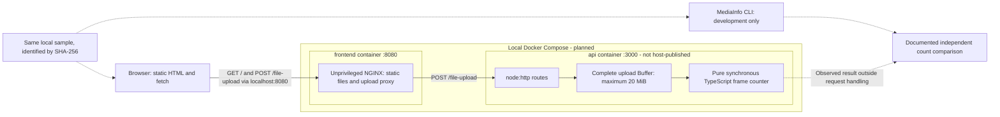
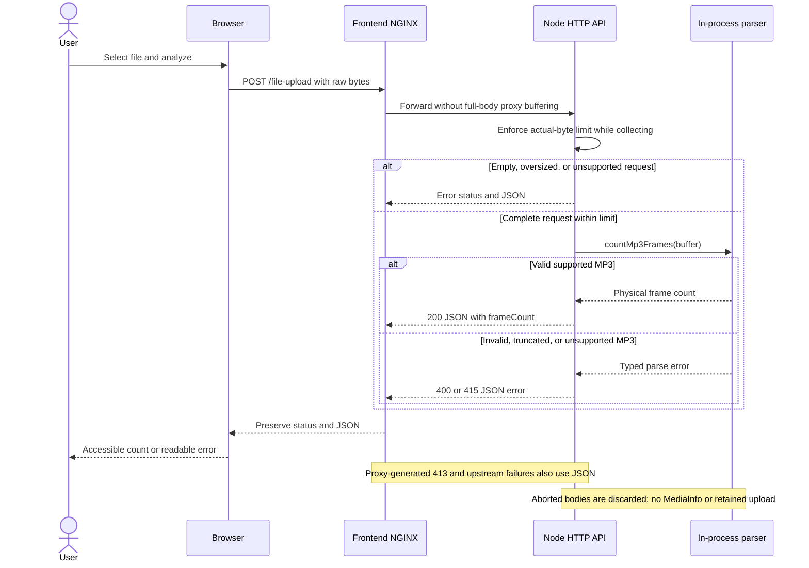
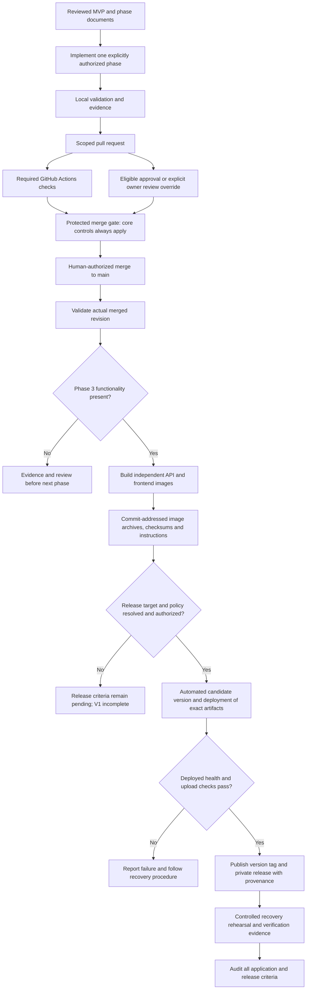

# Planned V1 architecture

> Rendering correction, 2026-10-09: this Markdown escapes Mermaid sequence-text semicolons only.
> The [byte-exact original](v1.original.txt) retains the recorded source hash.
> This syntax repair does not change requirements, historical claims or execution authority.

All views below describe the target state. No application, Dockerfile, Compose file or Makefile exists yet. Read
[the MVP contract](../mvp.md) and [decision reconciliation](v1-decisions.md) before implementation.

## Runtime and packaging boundaries

The browser uses one loopback origin. NGINX serves static assets on container port 8080 and forwards `/file-upload` to
`http://api:3000/file-upload`. The API listens on `0.0.0.0:3000`; its pure parser runs inside the same process.
MediaInfo is development verification tooling, never in either runtime image or request path.

The frontend Docker build context is restricted to `frontend/`: static files, its Dockerfile, `.dockerignore` and NGINX
configuration. It uses a verified pinned unprivileged NGINX image, with no Node runtime, npm install or bundler. The API
uses its own multi-stage Dockerfile with repository-root context for the single lockfile and TypeScript source. The
build stage installs locked development tools; the non-root runtime includes only required compiled/runtime files, an
exec-form startup command and graceful termination handling. Exclude UI files, tests, MediaInfo and agent artifacts.
Both images must build independently from clean contexts, without host `dist/`, dependencies or a running sibling.

Compose defaults to exactly `frontend` and `api`. Publish only `127.0.0.1:8080:8080`, with a documented host-port
override. API publication requires an explicit later debug option. Real health checks must use commands present in the
images; frontend startup depends on a healthy API. No privilege, host networking, Docker socket mount or upload volume.

## Upload and failure behavior

NGINX must match the 20 MiB API limit, disable proxy request-body buffering and explicitly use upstream HTTP/1.1. The
API still buffers the complete bounded body. Do not cache or persist uploads; use ephemeral tmpfs for required NGINX
temporary/body paths. Preserve API JSON and statuses. Proxy-generated 413 and upstream unavailable/timeout responses
must also be small JSON errors, with codes/messages documented in Phase 3.

Test through the frontend origin, including valid input above 1 MiB, exact/over-limit input and an unavailable API.
Local HTTP is intentional; TLS, public exposure and stronger resource/concurrency controls are outside this plan.

## Delivery and release gates

The review path includes either eligible independent approval or the owner's explicit configured review override. Core
CI/conversation/branch rules remain mandatory. Phase plans and agent reviews never substitute for that decision.

Image archives and Compose/Make instructions are the brief's delivery artifacts. The retained release amendment adds
version/tag/release automation, a selected authorized target, deployed verification and recovery evidence. The target
connection and version policy are unresolved prerequisites, not implemented arrows. Private repository releases are
compatible with the restriction on public publication; no cloud target is selected.

These authored views accompany schema-v1 system contracts. They are not generated architecture outputs or proof that the
runtime works. See [planning validation](../validation/v1-planning.md) for actual syntax/render checks.
