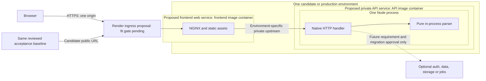
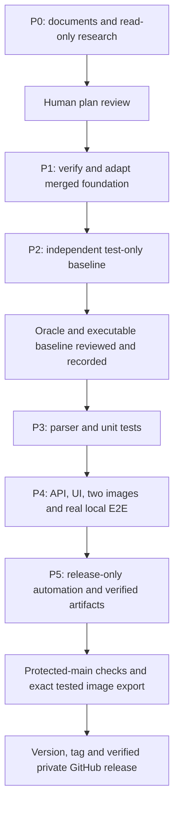

# V1 architecture and deferred hosting views

Status: the current [local MVP handoff](../deployment/local-handoff.md) takes priority under the
[2026-10-11 cloud pause](../deployment/v1-delivery.md#local-mvp-handoff-and-cloud-pause--2026-10-11). Actual phase
results are recorded in `docs/validation/`; diagrams alone do not establish execution. The existing authenticated stage
remains, while further hosted work and production v1.0.0 are deferred. See [requirements](../mvp.md),
[external contract](../testing/acceptance-contract.md), [deployment](deployment.md), [evolution](evolution.md) and
[decisions](decisions.md).

## Implemented boundaries and layout

### Current local Fastify architecture — 2026-10-11

The [backend audio-count amendment](../requirements/backend-audio-refactor.md) keeps Fastify 5.12.5 as the backend
framework. `createApp()` returns a real, unbound Fastify instance with registered schemas, plugins, hooks and routes;
callers can use `ready()` and `inject()` without listening. Construction reads no documentation assets and installs no
process signals or active deadlines. A second HTTP framework or parser dependency is unnecessary for this local target.

| Boundary                                                                                                                                                                     | Current responsibility                                                                                                                                                                                                                                        |
| ---------------------------------------------------------------------------------------------------------------------------------------------------------------------------- | ------------------------------------------------------------------------------------------------------------------------------------------------------------------------------------------------------------------------------------------------------------- |
| [`app.ts`](../../server/src/app.ts)                                                                                                                                          | Compose shared schemas, canonical root headers/errors/raw-route guards, dynamic Swagger, the scoped upload plugin and a separate health plugin, in that order. Root close hooks connect the transport lifecycle.                                              |
| [`http.ts`](../../server/src/http.ts) and [`http/lifecycle.ts`](../../server/src/http/lifecycle.ts)                                                                          | Compose per-instance budgets, transport and app. Before production listening, await Fastify readiness and verified finite docs assets. Stop admission synchronously and own one bounded shutdown; only `index.ts` installs process signals.                   |
| [`http/upload-transport.ts`](../../server/src/http/upload-transport.ts)                                                                                                      | Supply Fastify's native server factory, preserving raw path/method/Expect precedence. In the upload scope, admit before allocation, collect one bounded Buffer, enforce byte/time limits and release once through terminal hooks and the handler's `finally`. |
| [`modules/mp3/routes.ts`](../../server/src/modules/mp3/routes.ts)                                                                                                            | Accept a complete body, invoke the analyzer once, project allowed fields, validate aggregate invariants and serialize the default or detailed DTO. Parser/domain failures enter the canonical root error handler.                                             |
| [`modules/mp3/analyze.ts`](../../server/src/modules/mp3/analyze.ts), [`mpeg.ts`](../../server/src/modules/mp3/mpeg.ts) and [`xing.ts`](../../server/src/modules/mp3/xing.ts) | Walk actual complete MPEG boundaries and inspect only the supported leading carrier. These synchronous modules perform no HTTP, filesystem or lifecycle work.                                                                                                 |
| [`contracts/mp3.ts`](../../server/src/contracts/mp3.ts) and [`contracts/errors.ts`](../../server/src/contracts/errors.ts)                                                    | Define browser-safe TypeBox schemas, interpreted success invariants and the closed error catalogue. Normal replies use registered serializers; early native rejection uses the same projected error DTO with bounded draining.                                |
| [`documentation/`](../../server/src/documentation/openapi.ts) and [`docs.ts`](../../server/src/docs.ts)                                                                      | Generate OpenAPI from the same factory's `ready()`/`swagger()` registration, then close the unbound app. Build packaging retains offline Redoc assets; runtime readiness loads the verified finite resource map.                                              |

Successful upload and API health requests reach Fastify's handler. The health plugin is a sibling of the upload plugin,
so it never enters upload admission or body collection. The retained native adapter handles early refusals and finite
`/docs` resources directly; docs requests also avoid upload hooks. An incomplete native error may hijack the reply for
bounded draining after release. These explicit transport boundaries preserve HTTP behavior around Fastify's application
lifecycle; they do not replace its upload routing, scoped hooks, schema serialization or shutdown ownership.

The current result is computed audio frames: one recognized leading Xing/Info carrier counts as one physical frame and
zero audio frames. Optional diagnostics expose walked physical/excluded counts and bounded declarations; declarations
never supply the result. The [runtime](diagrams/runtime.mmd) and [upload](diagrams/upload.mmd) views describe these
local source boundaries. Generation from registered schemas establishes the documentation source; actual Redoc
rendering, examples and CSP still require the separate verification record. Local source review does not establish
successor binding, publication, hosted acceptance or graceful operational drain.

The dated React, transport and documentation amendments below retain their original scope and evidence. In particular,
their unchanged-parser and physical-count wording describes the earlier shipped implementation, before this local audio
successor. Historical generated architecture remains intact.

**Local React amendment — 2026-10-11:** the owner authorized replacing the minimal browser script with React and
TypeScript for the local submission handoff. React builds into static same-origin assets served by NGINX and executes in
the browser. Fastify, the pure parser, raw upload JSON, resource protections and the two runtime containers remain
unchanged. This amendment describes the bounded migration; its checks, merge and publication need fresh evidence.

Within the browser, `App.tsx` composes typed page components. `useMp3Analysis` owns selection, admission, deadlines,
cancellation and retry state; services send the raw request and narrow unknown response data. Shared discriminated types
keep pending work separate from validated results and errors. These source boundaries add no runtime service or API
field. See the [frontend guide](../../frontend/README.md#source-boundaries).

**Migration amendment — 2026-10-10:** the current implementation replaces native application dispatch with Fastify
5.12.5 while retaining a narrow raw path/method/Expect refusal bridge. Ordered request admission precedes allocation;
the custom stream parser enforces actual-byte and time limits, and the POST route calls the unchanged pure parser. The
[migration evidence](../validation/fastify-transport.md#protected-main-completion) records PR #19, exact-head automated
approval, 82 unit tests, 67 passing protected-main external cases and v0.2.19 publication. Historical P4 evidence below
describes its original native transport.

**Documentation implementation amendment — 2026-10-10:** the API image additionally packages a finite set of generated
OpenAPI/Redoc files. Redoc 2.5.4 is a build-only dependency; the runtime reads bounded local assets at readiness and
serves only the six declared resources. Original vendor sources, map, license and notices are retained for inspection
but excluded from the public route map. The generator uses local inputs under BuildKit's denied-network build step.
NGINX proxies the docs namespace and solely supplies its scoped public CSP and security headers; the upload page keeps
its original policy. Renderer JavaScript executes in the browser, not a third container. These source changes require
the bound docs-v1 acceptance suite; [execution evidence](../validation/docs-implementation.md) records actual validation
and pending release status separately from the preceding transport milestone.

The browser uses compiled React/TypeScript assets and a relative upload URL. NGINX serves assets and proxies raw upload
bytes. The Fastify TypeScript API on Node collects at most 20 MiB and calls a pure synchronous parser in-process. The
parser now computes audio and physical counts with typed malformed/unsupported failures; it knows nothing about HTTP or
hosting. No runtime external parser, database, object storage, durable upload, job or account system exists in the
design.

The implementation lives in `server/src/`, `server/Dockerfile`, app unit tests, `frontend/` React/TypeScript/NGINX and
Dockerfile, the standalone `tests/acceptance/` package/fixtures/specs, root Makefile/Compose and release workflows. Root
npm owns application development tooling; acceptance owns its separate lockfile. Hosting research and proposals remain
separate from these implemented files.

Both images build independently from a clean checkout without host `dist/`, installed dependencies or a sibling service.
The frontend build uses the root locked toolchain to compile browser assets; its runtime retains only static assets,
NGINX and startup configuration. The historical frontend-only context/no-bundler design is superseded by this migration.
API uses separate TypeScript-build and production-dependency stages, then a supported pinned Node LTS runtime with
compiled API modules and the locked production graph. It runs non-root with an exec-form entrypoint and contains no
frontend source, application tests, MediaInfo, private plugin or development build toolchain. Pinned bases are recorded
in the Dockerfiles; [P4 evidence](../validation/p4-integration.md) records independent linux/amd64 builds and image
inspection.

The API listens on `0.0.0.0`, configurable PORT default 3000. NGINX uses local container port 8080. Compose contains
exactly two default app services, only frontend published to `127.0.0.1:8080` with a host-port override. API debug
exposure is opt-in. No privileged mode, host networking, Docker socket or persistent upload volume. Health checks and
startup waits are real and bounded; local health is not end-to-end readiness. Shutdown is intended to stop admissions
and allow active work to finish within a bounded deadline. The
[lifecycle evidence](../validation/lifecycle-controller.md) establishes actual straggler closure and normal exit;
graceful completion of an admitted response across operational SIGTERM remains unresolved. Neither a signal
acknowledgment nor a connection reset proves successful drain.

**Local lifecycle verification — 2026-10-11:** the final unbound audio-successor run passed all 72 independent local
cases. TC-07 observed the admitted response completing during actual SIGTERM and bounded exit in 5.9 seconds. This
clarifies the earlier unresolved local observation without claiming protected-main binding, hosted drain or production
readiness. See the [local refactor evidence](../validation/backend-audio-refactor.md#executed-local-verification).

Local NGINX upstream is `http://api:3000/file-upload`. Cloud upstream comes from explicit same-environment
configuration; Compose DNS is never assumed there. Implemented NGINX controls: inclusive 20 MiB body limit,
`proxy_request_buffering off`, explicit HTTP/1.1 upstream, upload caching disabled, preserved API JSON and normalized
local 413/502/504 responses. Streaming request forwarding does not make the API a streaming parser. NGINX documents that
chunked requests may still buffer unless upstream HTTP/1.1 or HTTP/2 is enabled; once forwarding starts it cannot safely
retry another upstream. See [proxy module](https://nginx.org/en/docs/http/ngx_http_proxy_module.html) and
[core body controls](https://nginx.org/en/docs/http/ngx_http_core_module.html#client_max_body_size), read 2026-10-09.

Use explicit ephemeral/tmpfs writable paths where the selected runtime supports them and no upload retention. Verify
whether the chosen managed host supports required mount behavior; an ephemeral filesystem alone is not a no-buffering
proof. API actual-byte enforcement remains mandatory. Review raw/body/filename logging, connection cleanup, aggregate
memory and synchronous parsing latency; black-box correctness alone cannot prove these properties.

## Local runtime and independent test boundary

[Canonical runtime diagram](diagrams/runtime.mmd) — source-linked to Compose, images, HTTP/parser code and the E2E
controller. Its nested boxes distinguish Docker/Compose, each application container and the single Node process that
contains the Fastify factory, scoped upload hooks/routes, native adapter, lifecycle and pure parser. NGINX serves
compiled React assets, but their JavaScript executes in the browser outside Docker. The API image compiles TypeScript in
a separate build stage and runs the compiled modules with exact locked production dependencies on Node.
[Diagram maintenance and viewing](diagrams/README.md) explains automatic updates and local SVG rendering.

The controller extracts the frozen suite outside the product checkout and runs its Playwright/Chromium processes on the
host. There is no acceptance runner image or third Compose service. The runner does not control Docker or mount product
source; the host/CI controller owns lifecycle and scoped cleanup. Independent packaging does not mean frontend analysis
works without its API.

## Historical managed topology and growth boundary

This preserved Render proposal belongs to the original P1–P5 planning context and is outside automatic source sync. The
later [versioned roadmap](../roadmap/README.md) recommends conditional Cloud Run ingress/sidecar revisions instead; its
[planned deployment view](../roadmap/diagrams/deployment.mmd) records that proposal. Existing authenticated Cloud Run
stage execution is distinct from these historical views and remains incomplete; no production service is deployed. The
historical diagram below retains the originally proposed native transport and service topology.

The dashed component is not deployed in V1. [Environment bindings](deployment.md#environment-bindings) keep candidate
and production pairs separate. Render is a conditional recommendation; no resources, entitlement or successful upload
are claimed. The proposed service containers retain the same frontend/API boundary and in-process parser; provider
support for the complete runtime contract still needs verification. OCI images, standard HTTP, external tests and small
explicit configuration preserve a later host change.

## Upload sequence

[Canonical upload sequence](diagrams/upload.mmd) — source-linked to the browser, proxy, API and parser. It covers
validation, success, errors and restored controls.

The immutable [r3 contract](../testing/acceptance-contract.md) owns historical original statuses, tags and
physical-count semantics. The independently bound [transport-v1 successor](../testing/contracts/transport-v1.md)
preserves those requirements and adds explicit transport/lifecycle checks under the
[transition policy](../testing/acceptance-transition.md). An abort cannot produce partial success. Unsupported layout
risk is explicit before baseline freeze. The local [backend audio target](../requirements/backend-audio-refactor.md)
changes count/error semantics through its independent successor process; the diagrams do not activate or prove that
binding.

## Planning and test-first phase gates

Arrows are dependencies. The later owner instruction authorizes ordered execution of all phases with distinct reviewed
handoffs; the later release-only amendment defers deployment. This manually maintained process view records policy, not
generated source behavior. Existing foundation work is preserved.

## Release verification without deployment

[Canonical release diagram](diagrams/release.mmd) — source-linked to the CI workflow, release preparation and publisher.
PRs validate the application; an eligible protected-main push exports the exact tested images and publishes a verified
private GitHub release. The view covers the integrated application; earlier foundation/test-only phases follow the
separate source-delivery path described in the [release guide](../deployment/release-only.md). The current cloud pause
disables automatic stage work without changing software publication or completing hosted verification.

The active [release-only guide](../deployment/release-only.md) defines publication and identical retry. The hosted
[runbook](../deployment/runbook.md) remains deferred. Syntax/render verification and source-sync evidence are recorded
in [Mermaid validation](../validation/mermaid.md).

## Local successor implementation — 2026-10-11

See the [backend refactor map](../validation/backend-audio-refactor.md) for the current local factory, canonical
schemas, audio-count convention, browser Ky boundary and generated OpenAPI. Its independently authored successor and
policy still need review/binding; the historical released architecture above does not establish those outcomes. Cloud
delivery stays deferred.
