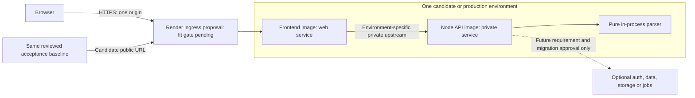
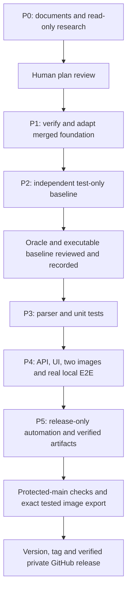

# V1 architecture and deferred hosting views

Status: implemented local boundaries under the [execution authorization](../phases/execution-authorization.md) and
[later release-only amendment](../requirements/release-process.md). Actual phase results are recorded in
`docs/validation/`; diagrams alone do not establish execution. Managed hosting is deferred. See
[requirements](../mvp.md), [external contract](../testing/acceptance-contract.md), [deployment](deployment.md),
[evolution](evolution.md) and [decisions](decisions.md).

## Implemented boundaries and layout

The browser uses static HTML/minimal JavaScript and a relative upload URL. NGINX serves assets and proxies raw upload
bytes. A native `node:http` TypeScript API collects at most 20 MiB and calls a pure synchronous parser in-process. The
parser owns physical-frame counting and typed malformed/unsupported failures; it knows nothing about HTTP or hosting. No
runtime external parser, database, object storage, durable upload, job or account system exists in the design.

The implementation lives in `server/src/`, `server/Dockerfile`, app unit tests, `frontend/` HTML/JavaScript/NGINX and
Dockerfile, the standalone `tests/acceptance/` package/fixtures/specs/runner Dockerfile, root Makefile/Compose and
release workflows. Root npm owns application development tooling; acceptance owns its separate lockfile. Hosting
research and proposals remain separate from these implemented files.

Both images build independently from a clean checkout without host `dist/`, installed dependencies or a sibling service.
Frontend context is only `frontend/`, with a verified pinned maintained unprivileged NGINX base and no API/npm source.
API uses a multi-stage TypeScript build and supported pinned Node LTS runtime, non-root, compiled API only, exec-form
entrypoint, no frontend/tests/MediaInfo/private plugin/build toolchain. Pinned bases are recorded in the Dockerfiles;
[P4 evidence](../validation/p4-integration.md) records independent linux/amd64 builds and image inspection.

The API listens on `0.0.0.0`, configurable PORT default 3000. NGINX uses local container port 8080. Compose contains
exactly two default app services, only frontend published to `127.0.0.1:8080` with a host-port override. API debug
exposure is opt-in. No privileged mode, host networking, Docker socket or persistent upload volume. Health checks and
startup waits are real and bounded; local health is not end-to-end readiness. Graceful termination stops admissions,
drains within a reviewed deadline, handles interrupted uploads and exits without retaining bytes.

Local NGINX upstream is `http://api:3000/file-upload`. Cloud upstream comes from explicit same-environment
configuration; Compose DNS is never assumed there. Implemented NGINX controls: inclusive 20 MiB body limit,
`proxy_request_buffering off`, explicit HTTP/1.1 upstream, upload caching disabled, preserved API JSON and normalized
local 413/502/504 responses. Streaming request forwarding does not make the API a streaming parser. NGINX documents that
chunked requests may still buffer unless upstream HTTP/1.1 or HTTP/2 is enabled; once forwarding starts it cannot safely
retry another upstream. See [proxy module](https://nginx.org/en/docs/http/ngx_http_proxy_module.html) and
[core body controls](https://nginx.org/en/docs/http/ngx_http_core_module.html#client_max_body_size), read 2026-10-09.

Use explicit ephemeral/tmpfs writable paths where the selected runtime supports them and no upload retention. Verify
whether the chosen managed host supports required mount behavior; an ephemeral filesystem alone is not a no-buffering
proof. API actual-byte enforcement remains mandatory. Review raw/body/filename logging, connection cleanup, aggregate
memory and synchronous parsing latency; black-box correctness alone cannot prove these properties.

## Local runtime and independent test boundary

[Canonical runtime diagram](diagrams/runtime.mmd) — source-linked to Compose, images, HTTP/parser code and the E2E
controller. [Diagram maintenance and viewing](diagrams/README.md) explains automatic updates and local SVG rendering.

The runner does not control Docker or mount product source. The host/CI controller owns lifecycle and scoped cleanup.
Independent packaging does not mean frontend analysis works without its API.

## Deferred managed topology and growth boundary

This manually maintained planning view is outside automatic source sync. It describes a conditional future proposal.

The dashed component is not deployed in V1. [Environment bindings](deployment.md#environment-bindings) keep candidate
and production pairs separate. Render is a conditional recommendation; no resources, entitlement or successful upload
are claimed. OCI images, standard HTTP, external tests and small explicit configuration preserve a later host change.

## Upload sequence

[Canonical upload sequence](diagrams/upload.mmd) — source-linked to the browser, proxy, API and parser. It covers
validation, success, errors and restored controls.

The [acceptance contract](../testing/acceptance-contract.md) owns precise statuses, tag proposals, precedence and count
semantics. An abort cannot produce partial success. Unsupported layout risk is explicit before baseline freeze.

## Planning and test-first phase gates

Arrows are dependencies. The later owner instruction authorizes ordered execution of all phases with distinct reviewed
handoffs; the later release-only amendment defers deployment. This manually maintained process view records policy, not
generated source behavior. Existing foundation work is preserved.

## Release verification without deployment

[Canonical release diagram](diagrams/release.mmd) — source-linked to the CI workflow, release preparation and publisher.
PRs validate the application; an eligible protected-main push exports the exact tested images and publishes a verified
private GitHub release. No provider deployment occurs.

The active [release-only guide](../deployment/release-only.md) defines publication and identical retry. The hosted
[runbook](../deployment/runbook.md) remains deferred. Syntax/render verification and source-sync evidence are recorded
in [Mermaid validation](../validation/mermaid.md).
