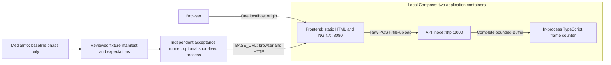
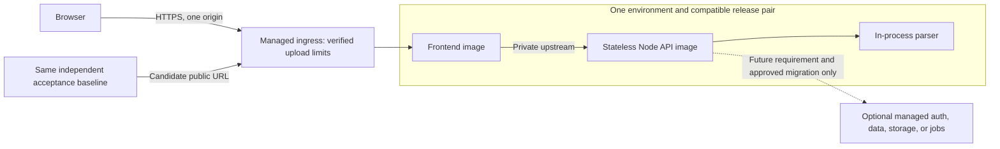
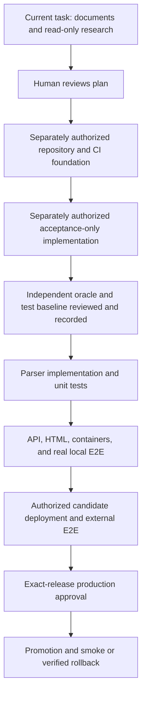
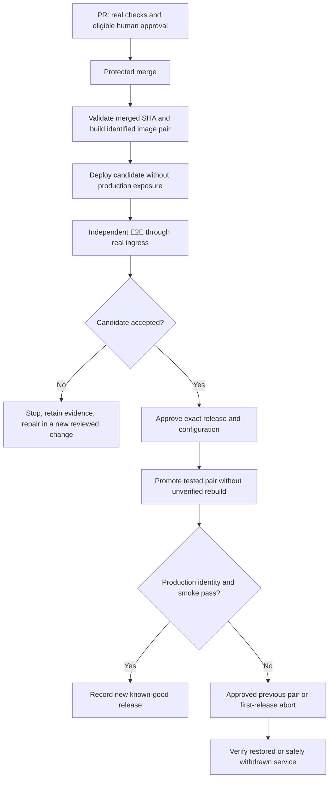

# MP3 Frame Counter — Unified Planning Prompt

## 1. Current task and authority

Use the installed `codex-mvp-orchestrator` to define and plan this project. **This is the planning task before any of the earlier prompts have been executed.** Treat the earlier MVP, deployment, and test-first prompts as drafts superseded by this consolidated instruction. This document is self-contained; do not execute an earlier prompt as a prerequisite.

**Produce planning documents only, then stop for human review.** Describe future implementation, test authoring, repository setup, and deployment without performing them now.

Allowed now:
- Read the workspace, existing instructions, Git metadata, and installed skill contracts. Preserve unrelated work.
- Consult official documentation and perform relevant read-only inspection of connected services, account capabilities, and nonsecret project metadata.
- Create or update Markdown specifications, decision records, Mermaid source, phase documents, role instructions, and supported planning metadata that is actually justified by verified decisions.
- Use already available, nonmutating tools to validate documentation. Clearly separate commands actually run from commands merely proposed.

Not authorized now:
- Application code, executable tests, fixture generators, validation adapters, or a working stub server/UI.
- Dependency installation, package manifests/lockfiles, runtime or test Dockerfiles, Compose, Makefile, CI workflows, or executable deployment configuration.
- Creating a Git repository, commits, branches, PRs, rulesets, secrets, environments, registry artifacts, or cloud resources; activating inactive resources; changing billing, accounts, domains, or production settings.
- Running E2E tests, deploying, promoting, rolling back, merging, enabling auto-merge, or automatically starting the next phase.

Writing a proposed plan does not make it approved. Writing an acceptance specification does not mean executable tests exist. Recording a proposed deployment does not mean a service has been provisioned or verified.

If unexpected implementation already exists, preserve it and report the discrepancy. Do not delete files or invent a test-first history. Work in the intended application directory, not inside the orchestrator's source repository.

## 2. Product goal and V1 boundaries

Build the smallest understandable application in which a user selects an MP3 in a browser, uploads it, and sees its MPEG frame count. V1 means this first functional product, not the orchestrator version or a mandatory semantic release number.

### Assessment requirements

- Write the API and MP3 parser in TypeScript.
- Expose `POST /file-upload` and accept an MP3 upload.
- Count frames by parsing MPEG Version 1 Audio Layer 3 data ourselves; other MPEG versions/layers are outside the assessment's required support.
- Do not use an npm package or external program to perform the application's MP3 frame parsing.
- Return the correct count as JSON with correct response headers.
- Provide useful errors, tests, clear running/testing instructions, and a Git repository demonstrating an incremental approach.

### Project choices to preserve

| Concern | V1 decision |
| --- | --- |
| Repository | Private GitHub repository, intended target `brobro10000/mp3-frame-counter`, default branch `main`; verify identity before any later mutation. |
| Frontend | Static HTML and minimal browser JavaScript; no frontend framework, bundler, or Node frontend runtime. |
| API | Native `node:http`; no HTTP framework. |
| Upload | Raw binary body, one file per request; not multipart. |
| Processing | Receive the complete bounded upload into memory before a pure, synchronous TypeScript parser counts frames. |
| Maximum upload | Exactly **20,971,520 bytes (20 MiB)**, inclusive. |
| Persistence | No retained uploads, database, object storage, upload history, or background jobs. |
| Packaging | Two independently built runtime images: frontend and API. |
| Local operation | Docker Compose starts the two services; a root Makefile provides thin convenience commands. |
| Dependencies | No production npm dependencies initially; npm and a locked development toolchain. A separate acceptance-test package/lockfile is an intentional exception, not a monorepo platform. |
| Independent validation | MediaInfo establishes and checks fixture evidence during development; never a runtime parser or fallback. |
| Acceptance | A separately owned, executable black-box suite is reviewed before product implementation. |
| Delivery | A real managed-service deployment process with candidate verification, explicit production approval, promotion, smoke testing, and rollback/abort procedures. |

The latest requirements replace the earlier “no cloud deployment” and “manual browser checks are sufficient” decisions. Separate containers replace the earlier single process serving both API and HTML. Do not preserve contradictory exclusions in the new documents.

Do not add streaming parsing, audio decoding, CRC checking, corruption recovery, accounts, billing, React, queues, workers, Kubernetes, Terraform, or a generalized orchestration framework to V1. Extensibility means retaining useful boundaries, not implementing speculative services. Acknowledge whole-file buffering and synchronous parsing as deliberate concurrency limitations.

## 3. Define the public contract before tests or implementation

### Browser and HTTP behavior

The page has a labeled file input, an **Analyze MP3** button, and accessible pending/result/error text. Prevent duplicate submissions while a request is pending, then allow another upload after success or failure. Use safe text rendering. No player, drag-and-drop, history, or progress-percentage feature.

The browser submits the selected File as raw bytes to the relative URL `/file-upload`, explicitly using `Content-Type: audio/mpeg`. The API also accepts `application/octet-stream`. MIME type and filename are not proof of valid MP3 data. Document raw-body upload as our convention; the assessment did not mandate multipart.

| Surface | Contract |
| --- | --- |
| Frontend `GET /` | Serve the page and required static assets. |
| Frontend `/file-upload` | Route unchanged to the API; preserve the approved method, body, status, and response behavior. |
| API `POST /file-upload` | Collect bounded bytes, validate, parse, respond. |
| Each service `GET /healthz` | Lightweight health for that service; not proof the entire upload flow works. |
| Successful upload | HTTP 200, JSON content type, exactly `{ "frameCount": <positive integer> }`, matching the independent expected count. |
| Empty/malformed/truncated supported-format input | HTTP 400 and `{ "error": "Readable message" }`; never a partial successful count. |
| Over-limit upload | HTTP 413 and a usable JSON error for the contracted upload path. |
| Unsupported media type, content encoding, MPEG version/layer | HTTP 415 and JSON error. |
| Unknown API route / unsupported method | 404 / 405; include `Allow` where applicable. Do not impose API JSON behavior on unrelated static-file 404s. |
| Unexpected API failure | HTTP 500 with a readable error, no internal stack trace. |
| Controlled proxy upstream failures | Define consistent 502/504 JSON errors and useful frontend behavior. |

Enforce received bytes, not just `Content-Length`. Stop accumulating when the limit is exceeded; handle incomplete/aborted requests without a partial count, leaked state, or an unhandled rejection. Plan tests that distinguish a usable rejection from merely resetting the connection.

Resolve error precedence, health response details, and supported metadata layouts in the acceptance contract before freezing tests. Prefer fixtures isolating one invalid condition. Do not invent uniform precedence across independently rejecting ingress layers without verifying it. The frontend must recover sensibly from network failures and unexpected non-JSON responses.

### Parser boundary and counting semantics

Plan a function equivalent to `countMp3Frames(bytes: Buffer): number`, with a small typed error mechanism. Keep it independent of HTTP, frontend code, provider SDKs, storage, and deployment configuration.

The proposed algorithm is to skip supported bounded leading ID3v2 metadata, exclude a recognized trailing ID3v1 tag, then walk complete MPEG frames by validating each four-byte header and calculating its length:

```text
frameLengthBytes = floor(144 × bitrateBitsPerSecond / sampleRateHz) + paddingBit
```

Research and cite necessary primary format sources before treating details as settled. Define the supported ID3 versions/header/footer forms explicitly; “supports ID3” is not a sufficient contract. Read bitrate/padding per frame for ordinary CBR/VBR support. Do not count sync-like payload bytes, infer frame count from file size/duration, trust Xing/VBRI totals as the application's answer, decode audio, or resynchronize through corruption.

Count complete physical MPEG frames, including a metadata-bearing MPEG frame when it is a complete frame under this definition. Separate ID3 records are not MPEG frames. Reconcile MediaInfo's reporting convention with this definition before accepting real-file expectations; never introduce an unexplained +1/-1 correction.

Free-format bitrate and unsupported tag layouts must be identified as first-pass limitations, not exclusions granted by the assessment. Record residual assessment risk and unsupported-input behavior honestly. Do not broaden the parser merely to add an elaborate fixture collection.

## 4. Independent packaging and local operation

Plan two small, independently buildable runtime images:

**Frontend:** a pinned, maintained unprivileged NGINX image, static files, and upload proxy configuration. Its build context is `frontend/`; it contains no API source or npm toolchain. Local container port is 8080, with `/file-upload` forwarded to `http://api:3000/file-upload` through Compose networking.

**API:** a multi-stage build compiles TypeScript, then a non-root supported Node LTS runtime runs only the compiled API. Listen on `0.0.0.0` at the configured port, default 3000. Exclude frontend assets, tests, MediaInfo, private orchestration code, and build tools. Plan clean termination and an exec-form entrypoint.

Use verified versions/digests and a documented build architecture later; never fabricate them. Both images must build from a clean checkout without preexisting `dist/`, installed dependencies, or a running sibling service. Independent packaging does not mean the frontend can analyze files without an API.

Compose has exactly two default application services. Publish only the frontend on `127.0.0.1:8080`, with an overridable host port. Keep API debug exposure explicit. Use real health checks and bounded startup waits. No privileged mode, host networking, Docker socket mounts, or persistent upload volumes.

Align frontend/API limits. Plan NGINX request streaming to the API, appropriate upstream HTTP settings, no caching, and ephemeral required temporary paths; the API still buffers the whole file. Check the behavior against current NGINX documentation. Preserve API JSON and normalize contracted proxy errors. Do not claim configuration alone proves an absence of provider-side buffering or retention.

The browser uses one origin and never sees a Docker service hostname. Local/cloud differences belong in small explicit configuration, not duplicated application code. In particular, a cloud deployment must not assume Compose DNS names exist.

## 5. Deployment selection and an extensible deployment contract

### Recommended architectural direction

**Prefer a small managed-container deployment that can run the existing frontend and API images, with HTTPS ingress to the frontend and a private API connection.** Preserve the raw 20 MiB upload contract end to end. This is the recommended architecture to evaluate, not an assertion that a particular connected provider supports it.

Use provider-native deployment configuration and a few ordinary scripts when later authorized. Do not build a provider-neutral deployment language, adapter framework, or infrastructure platform. Portability comes from standard image artifacts, the HTTP contract, explicit configuration, and an external test suite.

### Read-only provider evaluation

Inspect connected **Vercel and Supabase** first using their actual tools and current official documentation. A connection does not prove project availability, billing entitlement, runtime compatibility, or permission to deploy. Retrieve only necessary nonsecret metadata; do not repurpose an unrelated project, activate an inactive one, or change resources.

Compare at most three concrete paths:
1. Vercel's currently supported runtime/container/service topology.
2. A Supabase-based path only where its actual runtime capabilities could fit; do not assume Edge Functions are interchangeable with the unchanged Node/container API. Separately assess Supabase as a possible future managed data/auth service.
3. One conventional managed-container alternative if the connected options cannot satisfy the fixed contract. Discover available integration support before claiming access is impossible.

For each, cite dated official evidence for runtime/image support, request-body limits at **every hop**, buffering and temporary storage, execution/CPU/memory limits, timeout/idle behavior, private networking, binary forwarding, error preservation, TLS, candidate URLs, rollout/rollback, account eligibility, and small-project cost/usage controls. Separate documented support from behavior still requiring a later probe.

Do not assume container support removes function/gateway restrictions. Recheck any previously discussed payload limits rather than using them as timeless facts. A working health endpoint or tiny upload is not proof a 20 MiB upload can traverse the deployment.

A static Vercel frontend with an external container API is only an alternative proposal: verify the whole upload path and explicitly explain any departure from deploying both images, same-origin routing, or the no-CORS baseline. Do not silently make a serverless gateway the upload bottleneck.

Reject incompatible paths rather than reducing the limit, splitting uploads, adding object storage, moving parsing to the browser, adding a framework, or porting the API runtime. Such changes require a separate architectural decision. **Using no Supabase component in V1 is a valid outcome.**

Recommend one concrete provider when evidence is sufficient. Otherwise identify the smallest unresolved decision/access/budget prerequisite and preserve the container-oriented architecture. No current cost, plan, project identity, or entitlement may be invented. Provider approval is a planning gate before cloud-specific implementation/provisioning, not a reason to block unrelated requirements work.

### Environment and release boundaries

Define local, nonproduction candidate, and production environments. One staging slot is sufficient initially; ephemeral PR environments are optional. Candidate frontend/API routing must stay within the same release environment, never silently mix candidate and production services.

Use separately identified frontend/API artifacts, deployed as a compatible release pair. Prefer immutable image digests; where a source-build provider is chosen, record immutable deployment identities and the exact output actually tested. Source SHA alone is not binary identity. Keep environment-specific runtime configuration explicit and versioned without storing secrets in Git or images.

Document health, readiness, graceful shutdown/draining, request timeouts, memory/concurrency limits, redacted logs, deployment status, and cost controls. Upload bytes, filenames, sensitive headers, and credentials must not appear in routine logs. Public-hosting safeguards must not expand into an application account system.

Independent services do not guarantee atomic deployment. Specify promotion/rollback ordering, compatibility during any overlap, and abort behavior if only one service updates. Prefer switching a tested release pair where supported; do not invent atomic guarantees. The first production release has no prior known-good version, so define safe abort rather than fictitious rollback.

### Grow through explicit triggers, not speculative infrastructure

Include this evolution table in the architecture decision, refining triggers without implementing later components:

| V1 choice | Boundary preserved now | Trigger for a later change | Possible later step |
| --- | --- | --- | --- |
| Stateless Node API | HTTP contract, configurable port, health/shutdown, no local durable state | Measured concurrency, memory, or latency exceeds the agreed operating budget | Tune resource limits, then add replicas; evaluate worker/streaming changes only from evidence. |
| Bounded whole-file parser | Parser independent of transport and hosting | A legitimate larger-file requirement or measured memory pressure | An approved streaming/incremental parser; asynchronous jobs require a new/versioned contract, not a silent response change. |
| Static frontend and one-origin routing | Frontend/API separation; environment-selected upstream | UI complexity or additional backend routes | Evolve frontend or routing independently while preserving endpoint behavior and acceptance coverage. |
| No database or authentication | No provider imports in parser; trust/data boundaries documented | Approved history, persistence, or multi-user access requirement | Evaluate Supabase or another managed service; introduce a small data/auth boundary, policies, migrations, and tests when needed. |
| No storage or queues | Upload lifecycle and no-retention promise explicit | Approved durable/long-running processing requirement | Add retention/access/deletion policy, storage and workers only with revised product contracts. |
| Compatible image pair | Per-service artifact identity plus release manifest | Different deployment cadences create real friction | Separate releases after compatibility tests and rollout ordering exist. |
| One candidate environment | Configuration separated from images; suite accepts an external URL | Concurrent work actually needs isolation | Add limited ephemeral previews with teardown/TTL and spend controls. |
| One managed host | OCI images, standard HTTP, explicit nonsecret configuration | Cost, region, compliance, or operational requirements change | Migrate the same application artifacts and rerun the external suite; replace deployment configuration, not business logic. |

Any later persistence introduces migration/backup/restore considerations. Prefer additive, backward-compatible migrations and explicit irreversible-change approval; rolling back application images alone is not a data rollback. This is a future policy, not permission to create a schema now.

## 6. Independent acceptance-first development

### Sequence and ownership

Plan this order: approved observable contract → independently authored executable tests and fixture expectations → human-reviewed test-only baseline → product implementation → unchanged black-box tests against local and hosted systems.

**In this current task, write only the acceptance plan.** The executable suite, fixture generation, MediaInfo runs, negative controls, and runner image belong to a separately authorized future test-only phase. Foundation configuration is not product implementation; the tests must precede parser, HTTP server, browser application, and runtime-container implementation.

Use separate role documents and task contexts:
- **Acceptance author:** receives requirements and independent fixture evidence, not product implementation source; owns the acceptance suite and expected results.
- **Implementer:** may read the accepted suite, but cannot edit tests, expected counts, fixtures, thresholds, or gate logic to make implementation pass.
- **Reviewer:** reviews contracts, fixture provenance, test coverage, implementation, and separately justified contract/test amendments.
- **Release operator:** deploys an approved release identity; cannot weaken tests or approvals to release it.

These are roles, not additional application services or proof of distinct authenticated people. Markdown alone does not enforce access. Plan separate work scopes and eligible human review of test/workflow changes. Do not create a second test repository or mandatory parallel-agent system for this MVP.

### Standalone harness design

Plan `tests/acceptance/` as an independent TypeScript Playwright package, Chromium only, with its own lockfile and optional short-lived runner image. It tests browser and public HTTP behavior through **`BASE_URL`**. No imports or mounts of parser/server/frontend implementation or application configuration helpers; no runtime MediaInfo dependency.

The runner image has only the acceptance directory as build context and no Docker socket. A host/CI controller owns starting and stopping application containers. The runner is not a third default runtime service. Direct-API diagnostics may be separately labeled, but cannot replace acceptance through the public frontend/proxy path.

Use accessible role/label locators, isolated browser contexts, bounded waits, and real uploads. Do not mock successful upload responses in genuine E2E. Freeze fixture expectations independently and use a trusted reviewed test baseline in implementation CI—not a baseline or URL freely selected by the PR under test.

Plan a small result record containing suite revision, fixture manifest hash, target environment/deployment identity, passed/failed/blocked counts, and sanitized evidence references. Distinguish tool failure, missing fixtures, unavailable application, and failed behavior. Unknown deployment identity stays unknown.

### Independent oracle and fixtures

During the future test-only phase, locate the actual supplied sample and use an available, authorized MediaInfo installation. Record tool version, exact commands, SHA-256, bytes, MPEG version/layer, bitrate mode, reported count, and the reviewed expected physical frame count. Do not assume a sample path survives into another environment.

Proposed commands to verify later—not commands claimed to have run now:

```sh
mediainfo --Version
mediainfo --Full --Output=JSON "$FILE"
mediainfo --Inform='Audio;%FrameCount%' "$FILE"
```

A missing count is not zero. A missing tool/sample or unexplained discrepancy blocks that oracle, not all unrelated planning. Reconcile Xing/Info conventions using primary evidence; never tune expected answers to application output.

Plan a compact fixture manifest with stable IDs, provenance/license, byte length, SHA-256, expected result, and supporting evidence. Use real encoded audio cross-checked with MediaInfo plus tiny independently specified structural cases. Label structural fixtures that are not decodable audio. Do not write a second production-style parser to generate expected answers or import the application parser into generators.

Use at least three different valid expected counts to detect a hardcoded answer. Keep CI self-contained with permitted public/self-generated fixtures; the private assessment sample stays untracked unless redistribution is explicitly allowed. Large boundary fixtures may use a reviewed deterministic construction recipe, not a committed collection of large binaries. A successful exact-limit fixture must be a structurally valid supported file, not garbage.

MediaInfo provides independent baseline/reconciliation evidence, not an unquestionable oracle for every synthetic construction. Subsequent portable tests consume reviewed fixed expectations.

### Minimum acceptance matrix to specify

| ID | Scenario | Required observation |
| --- | --- | --- |
| AC-01 | Load frontend | Accessible input, Analyze action, and status/result area. |
| AC-02 | Valid HTTP uploads using both accepted MIME types | Exact JSON shape and independently expected positive integer, with different counts. |
| AC-03 | Browser selection and submission | Real upload traverses the frontend/API; displayed count matches the independent oracle. |
| AC-04 | CBR/VBR, padding, supported ID3, header-like payload bytes | Correct physical counts for independently characterized fixtures. |
| AC-05 | Empty, malformed, truncated input | 400 JSON; no partial count. |
| AC-06 | Unsupported media/content encoding or MPEG version/layer | 415 JSON using isolated violations. |
| AC-07 | Valid uploads above 1 MiB and around 6 MiB | Success through the complete ingress; add a case exceeding a candidate provider's relevant documented lower limit when necessary. |
| AC-08 | Valid exact 20 MiB upload and one byte over | Exact-limit success; over-limit usable 413 JSON. |
| AC-09 | Over-limit request without Content-Length | External controlled HTTP client sends actual bytes; real limit enforcement rather than header-only checking. |
| AC-10 | Known routes, methods, and health | Approved status, content type, and `Allow` behavior. |
| AC-11 | Pending state, invalid file, and another upload | Prevent duplicate submission while pending; show errors and recover. |
| AC-12 | Abort and unavailable API | No partial success; subsequent health/upload recovers; documented proxy/UI failure behavior. |

Run portable functional cases locally and against a nonproduction candidate with the same expectations. Fault injection and deterministic network-delay checks are confined to explicitly controlled environments. Do not kill production services or run boundary/stress tests against arbitrary URLs. Production smoke is smaller: release identity, UI availability, and one small known-count upload.

Black-box tests cannot prove no hidden provider persistence, bounded memory, absence of prohibited source dependencies, or independent human review. Assign those requirements to configuration/source review or separately labeled operational evidence.

### Honest test-first evidence and change control

Before an application exists, an unavailable server is **not** meaningful behavioral TDD red. Plan targeted disposable negative controls proving exact-count/shape assertions reject deliberately wrong answers. Keep those controls test-only; they are not a fake application or E2E success.

Report separately: harness valid; negative controls observed; baseline reviewed; real application acceptance not run/blocked. After product implementation exists, record actual failing behavioral assertions and their eventual passing result. Preserve failures. No unconditional expected-failure modes, zero-test success, suppressed exceptions, or skipped mandatory tests to manufacture readiness.

Test baseline changes require a distinct reviewed contract/oracle amendment and renewed validation. The first baseline must be reviewed and recorded before product work begins. Do not make a claim of immutable or tamper-proof tests where the tooling and permissions do not enforce it.

## 7. GitHub, CI, and production delivery

### Repository controls to plan, not apply now

Require PRs into `main`, at least one eligible independent human approval, dismissal of stale approvals, latest-push approval by another eligible reviewer, resolved conversations, passing required checks, and an up-to-date branch. Block force pushes/deletion, use squash merging, and configure no bypass actors. Verify actual plan support and identities later; neither commit author metadata nor an agent's `APPROVE` document establishes GitHub reviewer eligibility.

Plan a single minimal documentation-only initial commit if an empty repository requires it, explicitly recorded as the bootstrap exception. All substantive changes follow protected PRs. Do not copy the orchestrator repository's approval count or administrative settings without comparing them to this policy.

Use GitHub-hosted runners, least-privilege tokens, pinned Actions, bounded jobs, and no PR-exposed deployment/admin credentials. Do not run PR code through privileged `pull_request_target` execution. Disable automated review approvals. Keep repository administration separate from application CI and verify live rule/check identities rather than guessing.

Use a stable required terminal gate with explicit phase-appropriate mandatory dependencies. Failed, cancelled, missing, or unexpectedly skipped dependencies must fail it. Early planning/harness checks must not be labeled application acceptance. Once the integrated application phase begins, real E2E becomes mandatory and cannot be bypassed by selecting an earlier phase. Proposed commands are not observed passing evidence.

### Release process to document

1. Validate the scoped PR. Once the system exists, build both images and run the trusted acceptance baseline through local frontend ingress. Clean up containers even on failure.
2. Obtain eligible human approval and merge through the protected gate. Do not enable autonomous merging in this project task sequence.
3. Build and validate the actual merged revision; identify frontend/API artifacts by immutable digests or verified provider artifact identities.
4. Deploy that pair to an identified candidate environment, await bounded readiness, and resolve its URL from trusted provider output.
5. Run the same independent suite through the real candidate ingress, including large and exact-limit uploads. Provider “ready” and health checks are insufficient.
6. Bind evidence to source SHA, suite baseline, fixture manifest, both artifacts, environment, and nonsecret configuration identities. Review production approval for that exact release.
7. Promote the tested artifacts without rebuilding. Where environments/configuration differ, identify the differences and validate the production-intended configuration; never claim a changed output was tested. If a provider rebuilds on promotion, choose a supported staged-release path or treat the new output as a new candidate requiring verification before exposure.
8. Verify the production release pair and perform the small production smoke. On failure, stop further promotion and follow the approved rollback/first-release-abort procedure.
9. Restore and verify the previous known-good compatible pair where one exists. Preserve evidence, clean up abandoned candidates under the scoped policy, and record the outcome.

Use one authoritative release path, not racing provider Git auto-production and CI deployments. Disable or gate competing automatic exposure only in a later authorized setup task. Serialize production changes; cancelling obsolete PR checks is acceptable, cancelling a partially executed promotion/rollback is not a safe default.

Keep a compact release manifest or CI artifact, not a release database. Record source and acceptance revisions, fixture hash, artifact IDs, environment/config identity, verification runs, approval, candidate/production identities, and prior known-good release. Do not expose secrets or hashes of low-entropy secret values.

Scope credentials to trusted release steps and supported provider authentication mechanisms. Do not assume every provider accepts GitHub OIDC. Candidate-access credentials stay in the trusted runner, never URLs, frontend code, screenshots, traces, or published artifacts. Validate target hosts and redirects before sending protected headers. A login page is not a passing app page.

Where private-repository environment approval is unavailable, document the precise manual approval limitation instead of claiming an enforced gate. No provisioning, spending, public exposure, promotion, or rollback happens under this planning prompt.

## 8. Makefile interface to describe, not implement

| Future target | Contract |
| --- | --- |
| `make help` | List commands and prerequisites. |
| `make up` | Build/start both local containers, wait for health with a timeout, then print the browser URL. Never deploy. |
| `make down` | Remove only this Compose project's resources; no global prune. |
| `make logs` / `make ps` | Inspect both local services. |
| `make check` | Run real phase-appropriate formatting, lint, type, unit, and build checks. |
| `make e2e-check` | Validate harness/fixtures/negative controls; never claim application acceptance. |
| `make e2e BASE_URL=...` | Run real black-box acceptance against an explicitly validated target. |
| `make smoke FILE="..."` | Exercise the frontend upload path against an applicable reviewed fixture expectation. |
| `make validate-sample FILE="..."` | Collect MediaInfo evidence and reconcile the independent expected count with the actual application when available. |
| `make deploy-candidate` / `make verify-candidate` | Explicit provider/environment/release identity, readiness, and external acceptance. |
| `make promote RELEASE_ID=...` | Release only the exact tested and approved candidate; never select an ambiguous “latest.” |
| `make rollback RELEASE_ID=...` | Explicit known-good release/environment, approval, restore, and verification. |

Make is a thin convenience layer over versioned npm, Compose, test, and provider commands, not a framework or security boundary. Quote paths, propagate failure, distinguish prerequisites, and never install host software silently. Normal users must be able to run/test the application without Codex or the private orchestrator.

## 9. Mermaid views to include in the plan

Create diagram source aligned with the approved contracts. All infrastructure and test execution below is **planned**, not observed. Refine provider labels after research; do not infer approval from a diagram. Validate syntax with available tools and report rendering as unverified when it was not performed.

### A. Local runtime and independent test boundary



### B. Planned cloud topology and growth boundaries



The dashed node is not deployed in V1. Produce separate candidate/production bindings in the deployment document; never route a candidate frontend to production by accident.

### C. Upload sequence

```mermaid
sequenceDiagram
    actor User
    participant Browser
    participant Frontend as Frontend and ingress
    participant API as Node API
    participant Parser as Pure parser
    User->>Browser: Select MP3 and analyze
    Browser->>Frontend: Raw POST /file-upload
    Frontend->>API: Forward bytes with bounded ingress behavior
    API->>API: Validate request and collect at most 20 MiB
    alt Invalid request or upload exceeds limit
        API-->>Frontend: Error status and JSON
    else Complete acceptable request
        API->>Parser: Count frames in complete buffer
        alt Valid supported MP3
            Parser-->>API: Frame count
            API-->>Frontend: 200 JSON with frameCount
        else Invalid or unsupported data
            Parser-->>API: Typed failure
            API-->>Frontend: 400 or 415 JSON
        end
    end
    Frontend-->>Browser: Preserve contracted response
    Browser-->>User: Count or readable error
    Note over Frontend,API: Ingress may reject oversize input first; contracted upload rejection remains usable
    Note over API,Parser: No MediaInfo call, retained upload, or background job
```

### D. Planning and test-first phase gates



These arrows are dependencies, not permission for the agent to execute successive phases.

### E. Release verification and recovery



## 10. Separate phase and agent documents

Do not imply earlier phases are complete. Use this planned sequence; map draft names to it without inventing historical migrations:

| Phase | Future authorized scope | Required exit gate |
| --- | --- | --- |
| P0 — Planning, current task | Requirements, architecture, provider evaluation, acceptance design, roles, and phases only | Human review; unresolved blockers explicitly assigned. No executable test or product code. |
| P1 — Repository/CI foundation | Approved repository setup, tooling, meaningful foundation checks, protections | Verified configuration and real checks; reviewable foundation PR. No product implementation. |
| P2 — Independent acceptance baseline | Test package, fixtures, MediaInfo evidence, harness controls, runner image, related test tooling | Reviewed/recorded test-only baseline preceding product work; harness evidence is not application E2E. |
| P3 — Parser | Pure TypeScript parser and unit tests using independent expectations | Known-count cases and sample reconciliation; acceptance fixtures unchanged. No HTTP/UI/runtime containers. |
| P4 — Integrated local product | Native API, static UI, separate runtime images, Compose, Makefile, real E2E | Both images independently build; full applicable local acceptance passes through frontend ingress. |
| P5 — Managed deployment | Explicitly authorized provider setup, candidate, external E2E, approval/promotion, smoke and recovery verification | Evidence-backed release, verified rollback/abort procedure, and reproducible reviewer handoff. |

Every future phase needs its own authorization and ends at a reviewable PR/evidence handoff. Do not automatically merge or advance. Locally validated, CI-passed, human-reviewed, merged, candidate-verified, production-approved, and deployed are distinct states.

Each phase document must specify objective, prerequisites, owned paths, read-only dependencies, non-goals, planned commands, acceptance evidence, human-review focus, and stop conditions. Keep them brief; do not duplicate requirements or maintain a second execution-state machine.

## 11. Planning deliverables and future layout

Create only meaningful documents, not empty scaffolding:

```text
AGENTS.md                              # Short shared rules and role/phase pointers
README.md                              # Current planning status; no fictitious working commands

docs/
  mvp.md                               # Canonical human-readable requirements and V1 limits
  architecture/
    v1.md                              # Boundaries, counting policy, Mermaid views
    deployment.md                      # Provider comparison, recommendation, environment bindings
    evolution.md                       # Extension triggers, migration path, deliberate non-goals
    decisions.md                       # Compact decision/proposal/blocker register with sources
  testing/
    acceptance-contract.md             # External behavior, fixture plan, matrix, precedence
    independence-and-baseline.md        # Ownership, review, evidence and amendment policy
  deployment/
    runbook.md                         # Planned release, approval, rollback/abort and cost controls
  phases/
    01-foundation.md
    02-independent-acceptance.md
    03-parser.md
    04-local-end-to-end.md
    05-managed-deployment.md
  agents/
    acceptance-author.md
    implementer.md
    reviewer.md
    release-operator.md
```

Combine related documentation only when it reduces duplication without mixing phase and agent responsibilities. Reference requirement IDs from tests/phases rather than copying whole specifications.

Describe—but **do not create**—the future implementation layout: `server/src/` and `server/Dockerfile`; `frontend/` with HTML/JavaScript, NGINX config, and its Dockerfile; app unit tests; standalone `tests/acceptance/` with its own package, fixtures, specs and runner Dockerfile; root Makefile/Compose; minimal provider configuration; and `.github/workflows/`. Keep the application and harness package boundaries clear without introducing workspace tooling.

The eventual sample baseline/evidence documents must contain actual observations, not placeholders marked as verified. In this planning pass, document the required evidence fields and acquisition procedure in the acceptance plan.

## 12. Orchestrator compatibility, open decisions, and stopping point

Inspect the installed plugin version and actual contracts. Use planning-oriented capabilities only where their prerequisites are satisfied. Do not upgrade the plugin, edit its source, copy its proprietary implementation, or invoke phase execution or full `ship-pr`/auto-merge.

Keep generated metadata in its contract-defined locations. Never fill unresolved values with guesses to pass a validator or represent proposed decisions as verified facts. If supported planning/bootstrap metadata requires reviewed inputs not yet available, stop that operation and report the blocker while completing the human-readable documents.

Check the actual validation interface before planning npm/Playwright integration. If a Python-only boundary or short timeout still applies, propose a small separately reviewed adapter or normal CI handoff with genuine failure propagation. Do not implement the adapter, weaken an allowlist, cram E2E into an incompatible timeout, or fabricate receipts. Application and acceptance commands remain independently runnable without the private plugin.

Do not add advanced containment profiles, model routing, GitNexus, parallel agents, or reusable receipt systems solely because the orchestrator exposes them. Use only capabilities genuinely required by the chosen supported planning route.

Conclude with:
1. The V1 definition and the specific draft decisions this document supersedes.
2. Documents created, diagrams validated or unverified, and any real read-only checks performed.
3. Recommended deployment provider/topology, evidence, unresolved access/budget/fit items, and the minimal extensibility path.
4. Acceptance-contract decisions still needed before the test-only baseline can be frozen.
5. A short risk register: risk, impact, owner, mitigation, and phase where it must be resolved.
6. The phase order and exact proposed scope for **P1 only**, clearly labeled not authorized by this run.

Report evidence as observed, documented, proposed, or blocked. Do not assign fake reviewers, digests, project IDs, timings, frame counts, costs, or completed milestones.

**Stop after the planning documents. Do not implement tests, application code, infrastructure files, repository setup, or deployment. Wait for a separate instruction authorizing one phase.**

### Official research starting points

Use current official documentation and record retrieval dates for material platform constraints. These references are starting points, not proof of account access, capability, or successful execution:

```text
https://developers.openai.com/codex/plugins
https://developers.openai.com/codex/guides/agents-md
https://nodejs.org/api/http.html
https://nodejs.org/api/test.html
https://docs.docker.com/build/building/multi-stage/
https://docs.docker.com/compose/how-tos/startup-order/
https://github.com/nginx/docker-nginx-unprivileged
https://nginx.org/en/docs/http/ngx_http_proxy_module.html
https://vercel.com/docs
https://vercel.com/docs/functions/limitations
https://vercel.com/docs/deployments/promoting-a-deployment
https://supabase.com/changelog.md
https://supabase.com/docs/guides/functions
https://supabase.com/docs/guides/functions/limits
https://playwright.dev/docs/best-practices
https://playwright.dev/docs/api-testing
https://playwright.dev/docs/docker
https://mediaarea.net/en/MediaInfo/Support/Fields
https://github.com/MediaArea/MediaInfoLib/blob/master/Source/MediaInfo/Audio/File_Mpega.cpp
https://ffmpeg.org/doxygen/trunk/mpegaudiodecheader_8c_source.html
https://id3.org/id3v2.4.0-structure
https://docs.github.com/en/repositories/configuring-branches-and-merges-in-your-repository/managing-rulesets/about-rulesets
https://docs.github.com/en/actions/reference/security/secure-use
```
