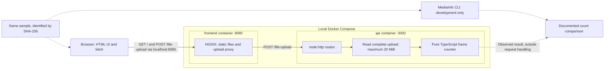
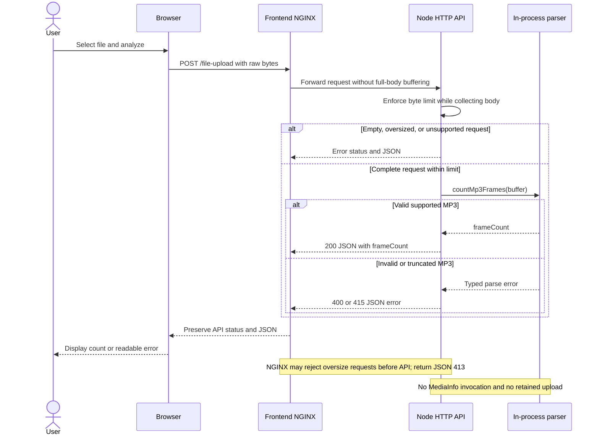
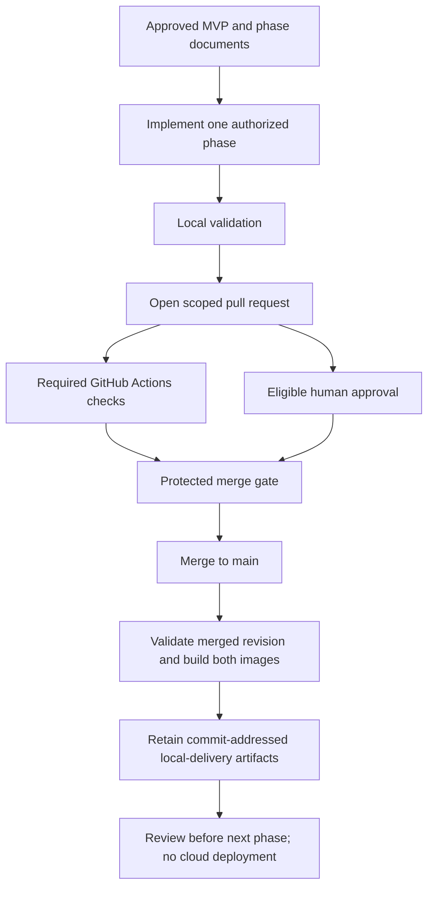

# MP3 Frame Counter — V1 Definition and Phased Delivery

> Rendering correction, 2026-10-09: this Markdown escapes Mermaid sequence-text semicolons only.
> The [byte-exact original](v1-planning-brief.original.txt) retains the recorded source hash.
> This syntax repair does not change requirements, historical claims or execution authority.

Use the installed `codex-mvp-orchestrator` plugin to capture and plan the following project. V1 means the first functional MVP described here, not a required release number or the orchestrator's version.

## 1. This task: definition and planning only

Create the project brief, architecture documentation, Mermaid diagrams, phase documents, and agent instructions. Stop for review before application implementation, Dockerfile/Compose/Makefile implementation, or GitHub mutations.

The requirements below describe the eventual V1, not authorization to implement all of it now. Later prompts will authorize one phase at a time.

Read the existing workspace, Git state, and project instructions first. Preserve unrelated work. Use a dedicated project directory, not the orchestrator source repository. If existing approved architecture conflicts with this brief, document the replacement and follow the installed migration contract; do not silently overwrite it.

The newly requested independent frontend and server containers explicitly replace our earlier single-process design in which Node served the HTML.

## 2. Product goal and fixed requirements

Build the smallest understandable application that lets a user select an MP3 in a browser, upload it, and see its frame count.

Assessment requirements:
- Implement the API and MP3 parser in TypeScript.
- Provide `POST /file-upload`.
- Parse the uploaded file ourselves to count MPEG Version 1 Audio Layer 3 frames.
- Do not use an npm package, MediaInfo, FFmpeg, or another external parser to calculate the application's result.
- Return HTTP 200 with `Content-Type: application/json` and exactly `{ "frameCount": <number> }` on success.
- Include useful errors, tests, and reproducible running instructions.
- Use MediaInfo independently to validate the result during development.

Our V1 choices:
- One private GitHub repository; intended target `brobro10000/mp3-frame-counter`, default branch `main`.
- One static HTML frontend, with only the small amount of browser JavaScript required.
- One native Node.js HTTP API using `node:http`; no HTTP framework.
- Receive the entire upload into a bounded `Buffer` before parsing.
- One pure, synchronous TypeScript frame-counting function, independent of HTTP.
- A 20 MiB limit: exactly 20 × 1024 × 1024 bytes.
- No retained uploads, database, object storage, or background jobs.
- Two independently built runtime images: `frontend` and `api`.
- Docker Compose and a root Makefile to run both together.
- No production npm dependencies initially. Use npm and one lockfile for server/development tooling; no workspace manager.

V1 deliberately excludes streaming parsing, audio decoding, CRC verification, corruption recovery, other MPEG versions/layers, authentication, cloud deployment, Kubernetes, Terraform, queues, workers, React, and a frontend bundler. Acknowledge that whole-file buffering and synchronous parsing limit concurrency; do not claim production-scale performance.

## 3. UI, transport, and routes

The HTML page contains a labeled file input, Analyze button, pending message, and result/error area. Prevent duplicate submissions while a request is pending. Use accessible status text and `textContent` for messages. No drag-and-drop, player, history, or progress-percentage feature.

Send the selected File directly with `fetch('/file-upload', ...)` as raw bytes. Explicitly set `Content-Type: audio/mpeg`; do not use FormData or write a multipart parser. Accept `audio/mpeg` and `application/octet-stream` at the API. Validate the bytes independently of the declared MIME type. Document that raw-body upload is our convention; the assessment did not specify multipart.

Routes:
- Frontend `GET /`: HTML and static assets.
- Frontend `POST /file-upload`: proxy unchanged to the API's exact `/file-upload` path.
- API `POST /file-upload`: receive, validate, count, respond.
- Each service `GET /healthz`: lightweight health response for its own container.

Use `{ "error": "Readable message" }` for application-generated errors:
- 400: empty or malformed MP3, including a truncated frame.
- 413: upload exceeds 20 MiB.
- 415: unsupported media type, content encoding, or MPEG version/layer.
- 404: unknown route; 405 with Allow for an unsupported method on a known route.
- 500: unexpected server failure; no stack trace in the response.

Do not base enforcement only on Content-Length. Check actual received bytes, stop accumulating immediately at the limit, and handle aborted/incomplete requests without a partial count or unhandled rejection. Test oversized requests receive a usable response rather than merely a connection reset.

Frontend validation is advisory. The server remains authoritative. Show a useful message for network failures and unexpected non-JSON responses.

## 4. Minimal MP3 parser contract

Use a function equivalent to `countMp3Frames(bytes: Buffer): number`, with a small typed error mechanism where needed. No parser class hierarchy, plugin interface, or framework imports.

Algorithm:
1. Identify and safely skip a supported leading ID3v2 tag; exclude a recognized trailing ID3v1 tag. Validate declared sizes and file bounds. Handle version-specific header/footer rules rather than guessing.
2. Starting at the audio region, validate the four-byte MPEG header at the current offset.
3. Require MPEG-1 Layer III and valid supported bitrate/sample-rate fields.
4. Calculate frame length from that frame's header:
   `floor(144 * bitrateBitsPerSecond / sampleRateHz) + paddingBit`.
5. Require the complete frame to fit, increment the count, and jump by that length.
6. Repeat until the audio region is consumed. Reject zero-frame, unexpected-byte, and incomplete-frame inputs.

Read bitrate and padding per frame so ordinary constant and variable bitrate inputs work. Do not estimate count from duration/file size, count sync patterns inside payloads, trust a Xing/VBRI count as the answer, decode samples, or resynchronize through corruption.

Count complete physical MPEG frames; separate ID3 records are not audio frames. State how metadata-bearing MPEG frames such as Xing/Info are treated and reconcile any difference with MediaInfo before declaring sample correctness.

Free-format bitrate encoding and unsupported tag layouts are documented V1 limitations, not formats the assessment explicitly excludes. Do not silently turn these limitations into broader compatibility claims. Research only the format details necessary to implement this small parser; write our own implementation rather than copying another library.

## 5. Independent Docker packaging and one browser origin

Frontend image:
- Its own Dockerfile, with build context restricted to `frontend/`.
- A pinned, maintained unprivileged NGINX image serving static files on container port 8080.
- No Node.js runtime, npm install, API code, or frontend compilation step.
- Proxy `/file-upload` to `http://api:3000/file-upload` using Compose service discovery.
- The browser uses relative URLs; it must never call the Docker hostname `api`.

API image:
- Its own multi-stage Dockerfile: a build stage installs locked development dependencies and compiles TypeScript; a non-root runtime stage runs compiled JavaScript.
- Listen on `0.0.0.0:3000` inside the container.
- Copy only required runtime files, not frontend assets, MediaInfo, tests, private agent files, or build tools.
- Use an exec-form startup command and handle termination cleanly.
- Prefer a supported Node LTS slim image; verify and record exact image versions/digests during implementation. Never invent digests or use floating `latest`.

Compose:
- Exactly two default runtime services: `frontend` and `api`.
- Publish only `127.0.0.1:8080:8080` for frontend; allow the host port to be overridden.
- Do not publish the API port by default. API debug access, if later needed, must be explicit.
- Use real health checks and make frontend depend on a healthy API, not merely a started container. Health-check commands must exist in their images.
- No privileged mode, host networking, Docker socket mounts, or persistent upload volumes.
- Both images must build independently without a local `dist/`, node_modules, or a running sibling service. Distinguish independent packaging from the API dependency of an upload.

Proxy correctness:
- Match the API's 20 MiB limit; NGINX must not retain its smaller default upload limit.
- Disable proxy request-body buffering and explicitly use HTTP/1.1 upstream so the proxy does not buffer an entire upload before forwarding it. This does NOT change the API's whole-file parser design.
- Do not cache or persist uploaded bodies. Use ephemeral tmpfs for any required NGINX temporary/body paths.
- Preserve API JSON errors and status codes. Return small JSON errors for proxy-generated upload 413 and upstream-unavailable/timeout errors; do not replace API errors with generic HTML.
- Test through the frontend URL, including a valid file larger than 1 MiB, oversize input, and an unavailable API.
- Local HTTP only. TLS/public exposure and stronger resource/concurrency controls are later decisions.

## 6. Makefile developer interface

Define these future targets; implement them only in their authorized phase:
- `make help`: commands and prerequisites.
- `make up`: build and start both containers with Docker Compose, wait for health with a bounded timeout, and print the browser URL only on success.
- `make down`: stop/remove this Compose project's resources only; no global prune.
- `make logs`: follow both services' logs.
- `make ps`: show service and health status.
- `make check`: formatting, linting, typechecking, tests, and build checks that actually exist at the current phase.
- `make smoke FILE="path/to/sample.mp3"`: exercise the upload through the frontend and validate response shape/content against applicable fixture expectations.
- `make validate-sample FILE="path/to/sample.mp3"`: collect MediaInfo evidence and compare with our result under the documented counting convention.

Use Make as a thin command wrapper, not an orchestration framework. Quote file paths correctly. Propagate failures. Explain prerequisites separately: Docker/Compose/Make for running; Node/npm for source checks; MediaInfo for independent validation. Do not silently install host packages.

Document `docker compose build api` and `docker compose build frontend` for independent builds. No live-reload stack or extra always-running development service in V1.

## 7. MediaInfo evidence and tests

Before implementing the parser, inspect the supplied sample with MediaInfo and record its SHA-256, size, MediaInfo version, MPEG format, reported frame count, and exact commands. Do not assume the sample exists at a path from a different environment.

Useful starting commands, verified against the available CLI:
```sh
mediainfo --Version
mediainfo --Full --Output=JSON "$FILE"
mediainfo --Inform='Audio;%FrameCount%' "$FILE"
```

Keep a compact baseline in `docs/validation/sample-baseline.md`. Repeat comparison after standalone parsing and after end-to-end integration. Record real results only. A missing FrameCount is not zero; unavailable tools, files, or unresolved discrepancies are blockers for sample verification, not passing checks.

Investigate any Xing/Info or metadata-related count discrepancy using primary documentation/source. Do not patch the parser with a sample-specific +1/-1. Synthetic fixtures must establish known physical frame counts independently.

MediaInfo is a developer/CI validation tool only, never a runtime dependency or fallback parser. Do not embed the supplied sample in an image or commit it without permission. User-provided local sample paths and machine-specific output should stay untracked where appropriate. Committed synthetic fixtures should make ordinary CI self-contained.

Minimum tests:
- Parser: known counts, per-frame bitrate/padding changes, ID3 skipping, header-like payload bytes, invalid/reserved fields, truncated tags/frames, and unsupported format.
- API: valid, empty, malformed, unsupported, and oversized uploads; actual-byte limit enforcement without Content-Length; interruption cleanup.
- Containers/proxy: both healthy, HTML loads, proxied upload has correct JSON, valid uploads above 1 MiB work, boundary limits agree, and expected errors survive proxying.
- Manual browser verification is sufficient initially. No Playwright/Jest/Vitest requirement; use Node's built-in test runner and assertions for automated TypeScript/server checks.

## 8. Separate product, phase, and agent documents

Proposed layout; create only planning documents in this task:
```text
AGENTS.md
README.md
Makefile
compose.yaml
package.json
package-lock.json
.dockerignore
server/
  Dockerfile
  src/
    server.ts
    upload.ts
    mp3.ts
frontend/
  Dockerfile
  .dockerignore
  nginx.conf
  index.html
  app.js
tests/
  mp3.test.ts
  upload.test.ts
  fixtures/
scripts/
  # Only small validation/smoke helpers actually needed later.
docs/
  mvp.md
  architecture/
    v1.md
  phases/
    01-foundation-and-baseline.md
    02-parser.md
    03-end-to-end-and-containers.md
  agents/
    implementer.md
    reviewer.md
  validation/
    sample-baseline.md
```

`docs/mvp.md` is the human-readable scope and contract. Phase documents define objective, prerequisites, owned paths, deliverables, acceptance criteria, commands, human-review focus, and stop conditions. Agent documents define responsibilities and handoffs; they are not autonomous services or a requirement for parallel agents.

Keep root AGENTS.md short: core constraints, where to read the active phase, validation expectations, and review/merge restrictions. Instruct the agent to load the relevant role document explicitly; do not assume arbitrary Markdown files are automatically loaded.

Keep orchestrator-generated contracts/state in their actual required locations. Do not invent schemas, copy its proprietary implementation into this repository, or maintain a conflicting second execution-state system in our phase documents.

## 9. Mermaid diagrams for V1

Create `docs/architecture/v1.md` with the following three Mermaid views. These are target-state diagrams; clearly label them as planned until implemented. Refine syntax, not scope. Preserve separate containers, an in-process parser, and development-only MediaInfo.

### A. Runtime and validation boundaries


### B. Upload sequence


### C. Delivery workflow


Validate Mermaid syntax with an available supported tool. Report rendering as unverified when unavailable. Keep the authored diagrams aligned with any mandatory orchestrator-generated architecture views; do not hand-edit generated outputs or claim these sketches satisfy an unrun validator.

## 10. Three reviewed phases

Phase 1 — Foundation and baseline:
- Repository, meaningful initial tooling/CI, protected PR controls, and actual MediaInfo baseline.
- No parser, HTTP application, dummy tests, or fake successful builds.

Phase 2 — Standalone parser:
- TypeScript frame counter, focused known-count tests, and MediaInfo reconciliation.
- No HTTP, UI, or container implementation.

Phase 3 — End-to-end and independent containers:
- Native API, HTML UI, both Dockerfiles, proxy configuration, Compose, Makefile, integration checks, and reproducible README.
- Prove the completed flow through the browser-facing URL and build both images independently.

Every phase ends at a reviewable PR and evidence report. Locally validated, CI-passed, human-approved, and merged are different states. Do not advance to the next phase without an explicit instruction.

## 11. GitHub and CI/CD controls for later implementation

Require PRs into main, one eligible human approval, stale-approval dismissal, latest-push approval by another eligible person, resolved conversations, passing required CI, and an up-to-date branch. Block force pushes/deletion, allow squash merges, and configure no bypass actors. Never replace human approval with an agent review artifact.

Verify permissions, plan support, PR author, and reviewer eligibility; my own GitHub account cannot approve a PR authored under that account. Report blockers instead of weakening controls or inventing another identity. Do not change settings or open a PR in this planning-only task.

Use GitHub-hosted runners, minimal token permissions, pinned Actions, and no secrets in PR jobs. No PR-controlled administrative token or privileged execution of untrusted changes. Observe the actual required-check name/integration before making it mandatory.

Use one stable required CI gate that fails when mandatory dependencies fail, cancel, or unexpectedly skip. Avoid path-filtering it out of docs-only PRs. Add checks as real functionality arrives: formatting, lint, typecheck, tests, build, Docker builds, and Compose smoke tests. Always clean up CI containers.

After a protected merge, validate the actual merged revision and retain separate API/frontend image archives plus Compose/Make instructions as short-lived Actions artifacts identified by commit SHA. Do not publish a registry image, create a public release, provision cloud services, or claim cloud deployment. Delivery jobs do not run on PRs.

## 12. Orchestrator compatibility and final response

Inspect the installed plugin and use only its available capabilities. Do not silently install/upgrade it or pretend missing validators ran. Repository administration and application CI remain distinct from generated-project bootstrap.

Check the actual executor contract before registering npm commands. If its Python-only validator boundary remains, plan a minimal reviewed adapter that runs fixed npm commands and reports genuine deterministic results with failure propagation. Keep npm scripts authoritative and application code in TypeScript. Never disable validation or introduce an unrestricted shell runner. Do not implement this adapter in the planning pass.

Do not invoke full `ship-pr`, enable auto-merge, or fabricate review/receipt evidence. Avoid advanced project profiles, model routing, GitNexus, parallel agents, and receipt machinery unless a selected installed capability genuinely requires them; report prerequisites rather than silently bypassing them.

Now produce only the approved-scope planning documents, valid architecture views, and supported planning/bootstrap metadata. Briefly report:
- What V1 includes and excludes.
- Decisions changed from the earlier single-process design.
- Created/updated documentation and diagrams.
- The three phases and their acceptance gates.
- Unresolved prerequisites and validation actually performed.
- The exact scope the next prompt should authorize: Phase 1 only.

Stop before application, infrastructure-file implementation, or GitHub mutations.

## Primary references for implementation research

Use the official sources below to verify details during the relevant phase. Documentation is not evidence that our implementation passed a check.

- Codex project instructions: https://developers.openai.com/codex/agent-configuration/agents-md
- Docker Compose readiness: https://docs.docker.com/compose/how-tos/startup-order/
- Docker multi-stage builds: https://docs.docker.com/build/building/multi-stage/
- NGINX unprivileged image: https://github.com/nginx/docker-nginx-unprivileged
- NGINX request limits: https://nginx.org/en/docs/http/ngx_http_core_module.html#client_max_body_size
- NGINX proxy request buffering: https://nginx.org/en/docs/http/ngx_http_proxy_module.html#proxy_request_buffering
- MediaInfo fields: https://mediaarea.net/en/MediaInfo/Support/Fields
- MediaInfo MPEG handling: https://github.com/MediaArea/MediaInfoLib/blob/master/Source/MediaInfo/Audio/File_Mpega.cpp
- MPEG header reference: https://ffmpeg.org/doxygen/trunk/mpegaudiodecheader_8c_source.html
- ID3v2.4 structure: https://id3.org/id3v2.4.0-structure
- GitHub required reviews: https://docs.github.com/en/pull-requests/how-tos/review-pull-requests/approving-a-pull-request-with-required-reviews
